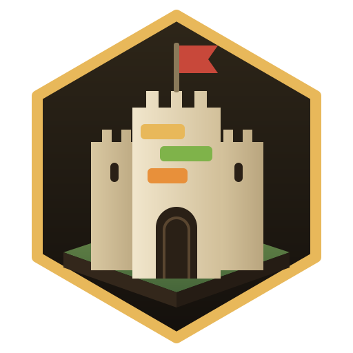
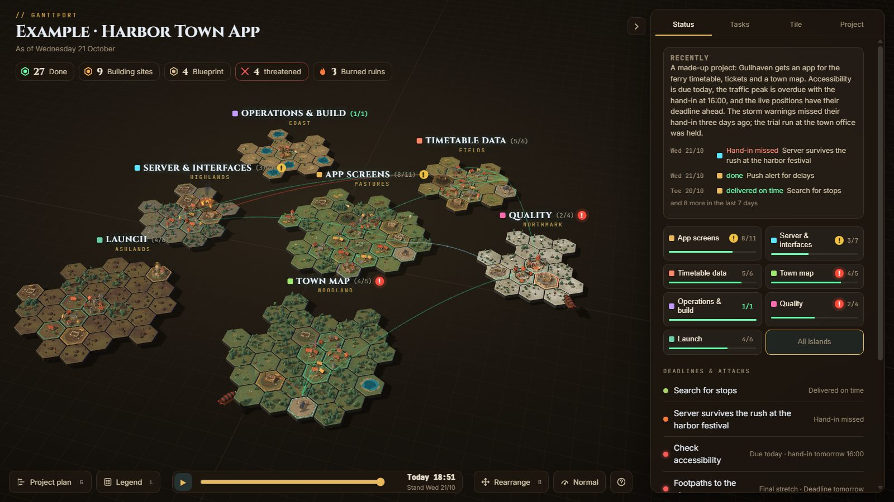

# Ganttfort

*Your project plan as a fortified world.*

Ganttfort turns a project plan into a 3D medieval island world. Every task is a building, every area of the project an
island, every deadline a wave of attackers. Finish in time and the attackers are beaten back; miss the hand-in and the
building burns down – the ruin stays, and slowly grows over.



**Live demo with a guided tour:** <https://tiedesv.github.io/ganttfort/> (English; add `?lang=de` for German)

## How it works

- **Tasks are buildings.** The kind of work decides the building: a farmstead for a new feature, a smithy for a fix,
  a scriptorium for docs, an observatory for research. Planned tasks are building plots, started ones building sites.
- **Deadlines bring attackers.** *Deadline ahead* (scouts circle), *Final stretch* (a war airship anchors at the island
  edge), *Due today* (siege), *Overdue* (battle), and the **hand-in at 16:00 on the day after the deadline**.
  Done by then: the attackers are beaten back. Otherwise the building burns down.
- **Moving a deadline is allowed – but visible.** Before *Deadline ahead* it is free; afterwards the attackers leave
  their siege gear behind.
- **Milestones are castles, large packages are churches** that grow into a cathedral with every finished task.
- **Old work gets lived in.** Finished buildings attract houses over the weeks.
- **A project plan comes with it:** a Gantt chart with dependencies, the critical path and every move of a deadline.

Everything runs locally in the browser. Nothing is sent anywhere.

## Three ways to use it

| You want to … | Take | How |
|---|---|---|
| just look at it, or plan something without a repo | `ganttfort.html` | Download it from the [latest release](https://github.com/TiedeSv/ganttfort/releases/latest) and open it. One file, works offline. |
| see your code project as a world, kept up to date by your AI agent | `ganttfort-template.zip` | Unpack it into the root of your repository and run `/world-init` in Claude Code or GitHub Copilot (agent mode). Details: [GUIDE.md](template/GUIDE.md). |
| have Claude set it up for you – in a repo or as a Claude Artifact in the claude.ai chat | `ganttfort-skill.zip` | Upload it as a custom skill in claude.ai, or unpack it into `~/.claude/skills/` for Claude Code, and say e.g. *"Create a Ganttfort world for my move to a new flat."* |

### In a repository

After `/world-init` the agent keeps the world up to date:

| Command | What it does |
|---|---|
| `/world-update` | Daily update from git: finished work, building sites, plans, explanations. |
| `/world-plan` | Takes over a plan that already exists in the repo (or suggests one) as a Mermaid Gantt in `.ai/ganttfort/plan.mmd`. |
| `/deadline tickets Friday` | Sets or moves a deadline – only when you say so. |
| `/milestone "Beta" 2026-11-15 a b` | Creates or changes a milestone. |
| `/explain` | Explains the current diff or a file. |
| `/world-theme` | Switches the theme or builds a new one. |

The world opens as `.ai/ganttfort/world.html` in the browser, without a server. Your data lives in
`.ai/ganttfort/world.json`; `python .ai/ganttfort/check_world.py` checks it and enforces the rules (for example: a
deadline never changes silently).

Coming from the old German version (`.ai/welt/`)? Run `python .ai/ganttfort/convert_world.py` once.

## Requirements

- A browser with WebGL (any current Chrome, Edge, Firefox or Safari).
- For the repo version: Python 3.8+ for `check_world.py`; an AI agent with file access (Claude Code, GitHub Copilot in agent mode); optionally the VS Code extension *Mermaid Chart* for diagrams.

## Build from source

```
python build/build_all.py
```

Only Python 3.8+ is needed. It creates in `release/`:

- `ganttfort.html` – the whole world in one file (works offline)
- `ganttfort-template.zip` – what goes into your repo
- `ganttfort-skill.zip` – the skill for Claude Code and the claude.ai chat

and in `build/dist/` the Claude Artifact version and the tour. To try the repo version directly, open
`template/.ai/ganttfort/world.html?demo`.

| Folder | What it is |
|---|---|
| `template/` | What users copy into their repository: the world, the medieval theme, agent rules, prompts and commands |
| `build/` | Build scripts, the Artifact app and the example world |
| `skill/` | The Ganttfort skill |
| `release/` | Build output (not checked in; attached to every GitHub release) |

## Support

Ganttfort is free. If it helps you, you can support it via [GitHub Sponsors](https://github.com/sponsors/TiedeSv).

## License

MIT, see [LICENSE](LICENSE). Third-party components (three.js, Mermaid, fonts): [THIRD_PARTY_NOTICES.md](THIRD_PARTY_NOTICES.md).
"Claude" is a trademark of Anthropic; this project is independent.
