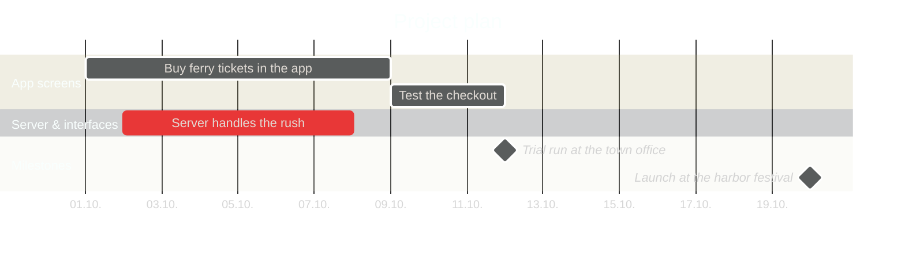

# Set up the project plan for the world (`/world-plan`)

The project plan is a Mermaid Gantt in **`.ai/ganttfort/plan.mmd`**. It is the only source of deadlines and
milestones: `check_world.py` transfers it into `world.json` on every run (end date = deadline, start date = planned
start). Every later date change is recorded automatically as a move.
I see the plan in VS Code as a Gantt chart (Mermaid extension) and change it there myself or let you change it.

## Steps

0. **Read the rules:** `.ai/ganttfort/rules.md` (repos, regions, off-limits folders; other repos are read-only).
   **If `.ai/ganttfort/plan.mmd` already exists**, do not create a new one. Instead: run `python .ai/ganttfort/check_world.py` and
   say in 2–3 lines what is in it (draft or valid, next deadlines). Make changes only if I name them.
   If I say "**accept plan**", delete only the line `%% draft`, check, and you are done.

1. **Look for an existing plan** (in all repos from `rules.md`, skip off-limits folders):
   - If I attach an export (Excel, CSV, MS Project XML, screenshot of a Gantt), it takes priority.
   - Mermaid `gantt` blocks in `.md`/`.mmd` files.
   - Files with `plan`, `roadmap`, `schedule`, `milestone`, `timeline`, `gantt`, `release` in the name
     (md, csv, xlsx, json, yaml, txt).
   - GitHub milestones and issues with a due date, if `gh` is available
     (`gh api repos/{owner}/{repo}/milestones`, `gh issue list --milestone …`).
   - Dates in the running text of README/ROADMAP/docs ("Release Oct 15", "by week 42").
   Take dates over **exactly** as they are written there: do not round them, do not make them "more realistic".
   Resolve vague dates and note it (`week 42` → Friday of that week, `%% Source: ROADMAP.md, "by week 42"`).

2. **No plan found → first draft:**
   - Tasks: all tasks with `in_progress` and `planned`, my own open branches, clusters of TODO/FIXME and follow-up work
     according to the work pattern in `rules.md` (e.g. build → check → docs).
   - Estimate durations: from the size (changed files, size of the diff) and from similar finished tasks
     (`started` → `ended`). Add **30 % buffer**, nothing due before the day after tomorrow, at most 2–3 tasks at the same time.
   - 1–3 milestones if groups emerge (release, handover, customer appointment).
   - **Large packages** for related work across several tasks (epic, work package, feature set).
     A large package has no deadline of its own; every task in it keeps its own.
   - Above every task, a comment line with the reasoning (`%% Estimate: 4 files, similar to search (3 d)`).

3. **Write `.ai/ganttfort/plan.mmd`** (format below):
   - At the very top **`%% draft`**, even for a plan you took over, so that I look over it once.
     Leave the line out only if I explicitly say "take over directly".
   - **ids = existing task ids** if the task already exists in the world. Otherwise new ids in kebab-case.
   - **`section` = region name** exactly as in `world.json` (e.g. `section App screens`), so that new tasks land in the
     right region. Milestones may go into their own `section Milestones`.
   - Every task with start and end (`2026-10-01, 2026-10-09`) or duration (`2026-10-01, 5d`);
     `after <id>` only for real dependencies. Careful: if the predecessor moves, the successor moves with it.
     The map draws arrows in the Gantt, lines in the world and the critical path from it.
   - If the source plan has summary tasks/epics/work packages, they become `%% package` lines.
   - The end date is the deadline: on that day there is a siege, on the day after there is a battle until 16:00.

4. **Preview:** validate the Mermaid and open it in the Mermaid extension, as described in `AGENTS.md`.
5. **Check:** `python .ai/ganttfort/check_world.py` until it says "OK".
6. **Answer (at most 6 lines):** where the plan comes from (file/source or "draft by me"), number of tasks and
   milestones, the next three deadlines, and the sentence: "Check `.ai/ganttfort/plan.mmd`, change what does not fit,
   then delete `%% draft` or say 'accept plan'. Only then do attackers come."

## After acceptance

- You change the plan only when I say so (`/deadline`, `/milestone` or in words). Never on your own,
  not even to prevent a fire.
- I may change the file myself at any time. Every changed deadline appears in the world as a move;
  after the scouts, siege gear stays behind. Deleting tasks from the plan does not remove their deadline.
- A task is still marked done via `world.json` (`status`, `ended`), not via the plan.

## Format

- `:milestone, id, after a b, 0d`: date = latest end of a and b, a and b belong to it.
- `:milestone, id, 2026-10-20, 0d` + `%% id includes: x y`: fixed date, x and y belong to it.
- `%% package id: Title = a b c`: large package (an umbrella over several tasks); in the world a large building, in the Gantt a summary bar.
- `crit` also marks a task as critical.
- Allowed tags before the id: `crit`, `active`, `done` (only looks in the preview), `milestone`.
- Only `dateFormat YYYY-MM-DD`. Durations in calendar days (`5d`, `2w`); `excludes weekends` is not taken into account.
